# PULSAR: Personal Unit for Learning, Support, Assistance & Reminders

*Your personal health companion in space.*

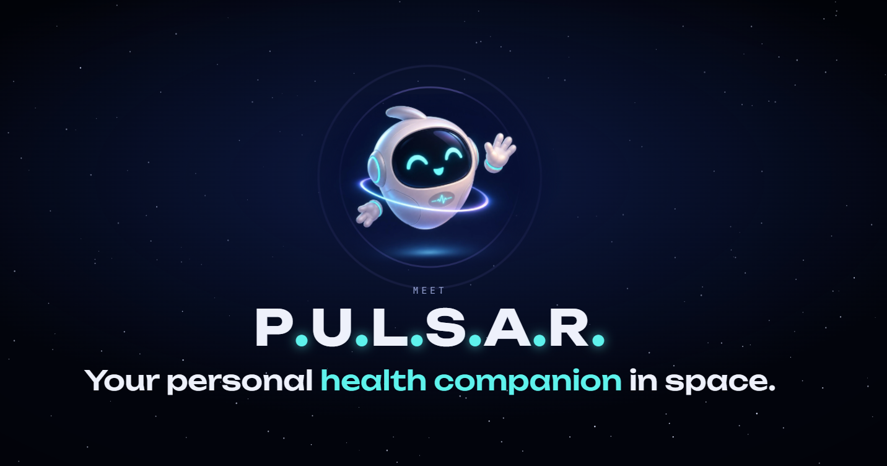

| Letter | Stands for | What it implies |
| --- | --- | --- |
| **P** | Personal | It belongs to one astronaut: it watches your face, logs your readings and keeps your data on your device. |
| **U** | Unit | A self-contained unit: it runs on one laptop, offline, with no network or cloud. |
| **L** | Learning | It teaches you to take care of yourself: step-by-step guides show how to take each measurement on a 3D body. |
| **S** | Support | Decision support, not diagnosis: explicit rules turn readings into green, amber or red and the next step. |
| **A** | Assistance | An assistant you talk or type to: it logs a measurement from one sentence, opens a guide or starts a relaxation exercise. |
| **R** | Reminders | It nudges good habits: reminders to sleep, move, drink water and relax, with streaks, levels and badges. |

## What PULSAR Does

PULSAR is an offline health companion for astronauts on long missions. It runs on the device, with no network and no cloud calls, so no crew health data leaves the spacecraft. It watches the astronaut's fatigue through the camera, tracks vital signs and cabin conditions, and guides the crew through measurements, relaxation and alerts, by voice, text or on-screen controls.

Today PULSAR specialises in one of NASA's official spaceflight risks: performance decrements and adverse health outcomes resulting from sleep loss, circadian desynchronization and work overload. It spots sleep-loss fatigue early through the camera, checks alertness with a reaction test and builds better sleep habits.

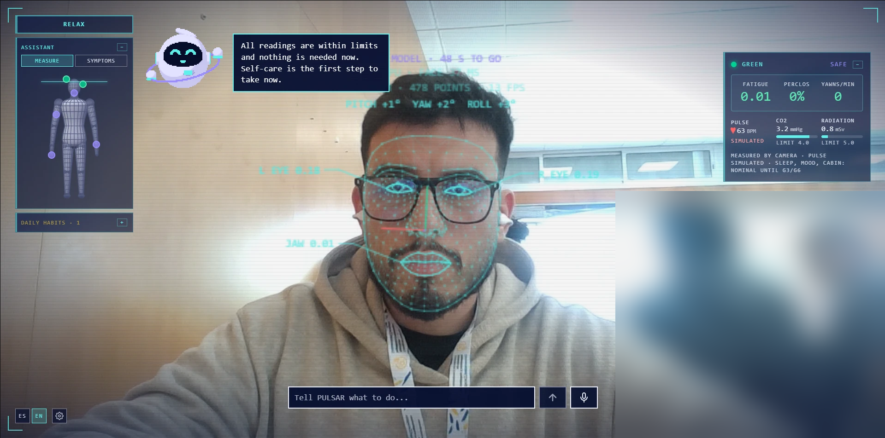

*Main screen. Fatigue, eye closure (PERCLOS) and yawns are measured live from the camera, drawn as a face mesh. In this demo the pulse, sleep, mood and cabin readings are simulated, and the screen says so.*

## How It Works

**1. Vision measures, nothing else.** A camera worker in the browser extracts eye closure, blink and yawn signals with MediaPipe. The fatigue classifier only estimates a fatigue score from those signals.

**2. A rules engine decides.** Eight rules turn fatigue, eye-closure, sleep, reaction time, mood, cabin CO2 and radiation readings into GREEN, AMBER or RED. Each rule states either its source or that its limit is a team assumption, and several limits are still placeholders to be calibrated. Heart rate, blood pressure, blood glucose and body temperature have no rule yet: PULSAR shows them and says they are not judged. The language model never decides a status, an escalation or a health judgement.

**3. Voice and text, through a closed list of actions.** The astronaut can speak or type, for example "log my blood pressure", "I drank three glasses of water", "how am I doing?" or "I'm stressed, help me relax". Speech recognition and the voice both run locally. The language model only chooses one action from a fixed catalogue and phrases two short sentences from the verdict. It cannot write an action, a number or a status on its own, and every number it passes on is checked against the bounds of the contract.

**4. A body twin that teaches the measurement.** A 3D body shows where each indicator sits. Selecting a marker opens a step-by-step guide with an animation that highlights each step.

**5. Habits, relaxation and a reaction test.** Four habits with a score and a streak, three guided relaxation exercises, and a short reaction test that can stop an alarm.

## Fill In Measurements With a Sentence

The astronaut does not have to type into a form. Saying or typing a sentence saves the value directly, and the measurement form shows it as logged. Every number is checked against the bounds of the contract before it is saved.

In the screenshots the astronaut said *"Today I had 8,5 hours of sleep"*. PULSAR answered "Logged: sleep 8.5", and the form shows "1 of 6 logged" with sleep at 8.5 h, in range, and the rules engine's verdict as GREEN.

A single sentence can also fill every measurement at once:

> *pulse 72, blood pressure 120 80, glucose 95, temperature 36.8, sleep 7, mood 4*

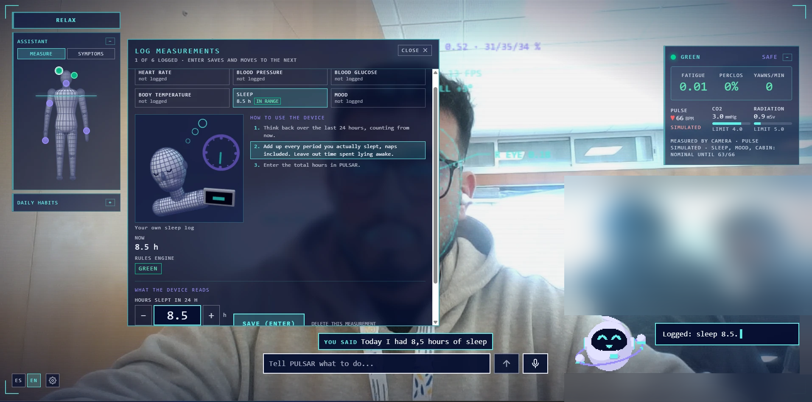

## Symptoms

Describing a symptom opens the information panel for the matching body zone, with what to do, possible problems and the NASA risk it relates to. PULSAR does not diagnose; it explains and points to the flight surgeon. Examples: "my head hurts" opens the head panel, "I have a pain in my back" opens the spine panel, and "I want to see my symptoms" opens the symptoms tab. PULSAR understands Spanish and English.

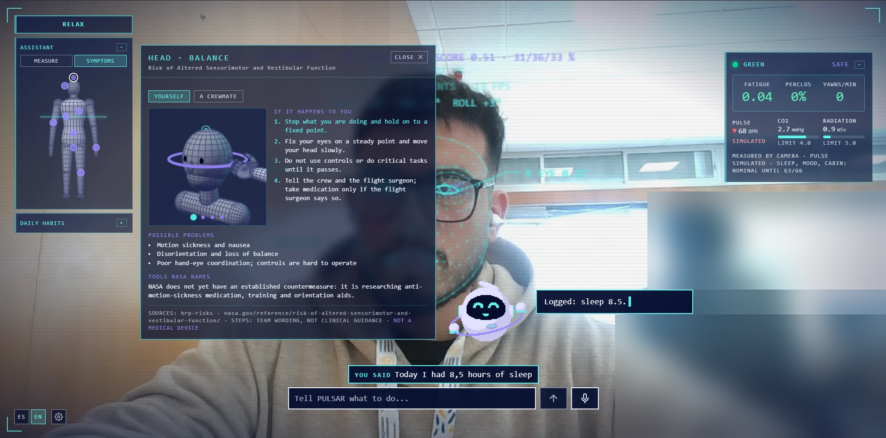

## Alerts

Three levels exist: green (safe), amber (tell the crew) and red (flight surgeon, act now). Each alert shows what to do, in order, and is stopped by acknowledging it or by passing the reaction test. The three screenshots below were triggered with the demo simulation over the live camera view, so the readings in them are simulated.

| Rule | Level | Limit in the demo |
| --- | --- | --- |
| Fatigue score high | Red | 0.70 (team placeholder) |
| Eye closure (PERCLOS) high | Amber | 11% of the time, from a public drowsiness dataset |
| Sleep under 6 hours | Amber | 6 h |
| Slow reaction time (PVT) | Amber | 320 ms mean (placeholder) |
| Low mood | Amber | 2 or less on a 1-5 scale (team assumption) |
| Cabin CO2 high | Amber | 4.0 mmHg (placeholder) |
| Radiation dose high | Red | 5 mSv (demo placeholder, simulated dose) |
| Arm asymmetry | Red | 0.35 (placeholder, secondary camera signal) |

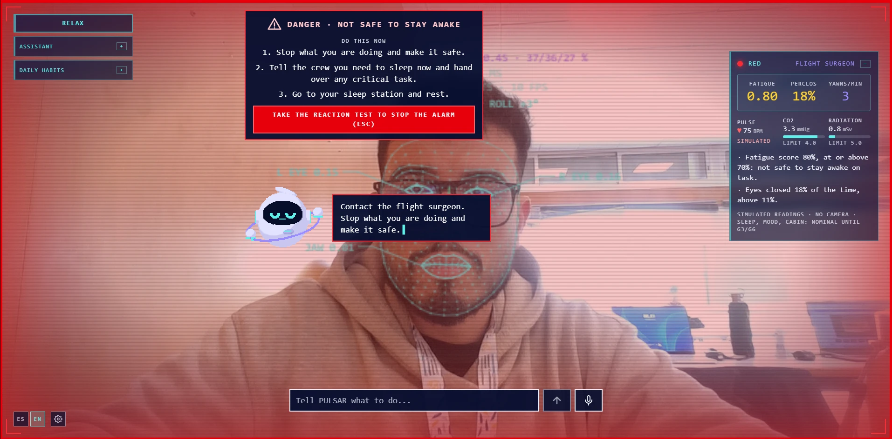
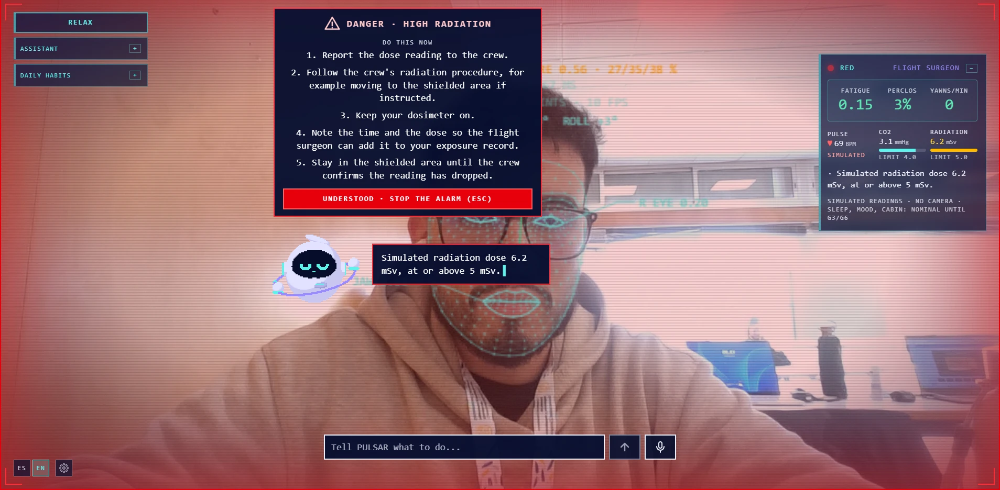
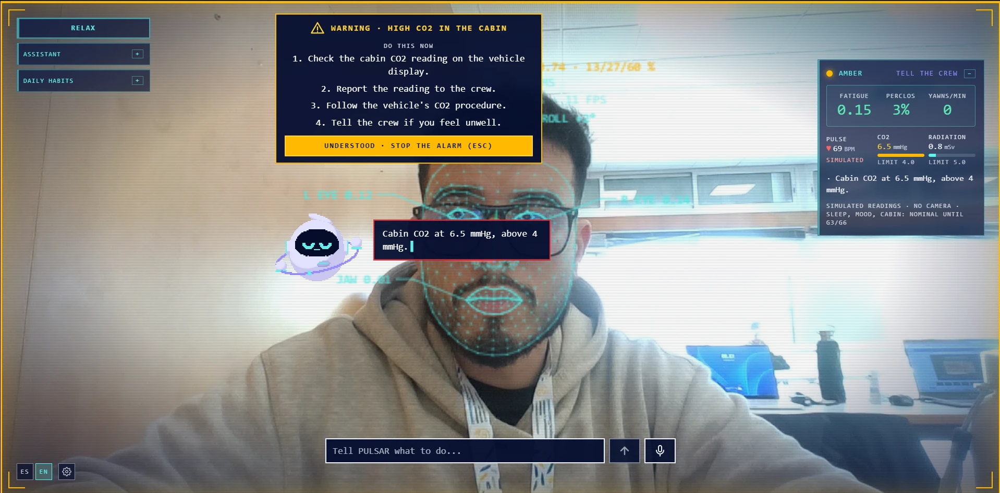

### Reaction Test

A fatigue alarm stops when the astronaut passes a short reaction test: three stimuli, each counted if the answer takes between 100 and 355 ms. Faster than 100 ms is a guess, 355 ms or slower is a lapse (the PVT-B criterion), and pressing too early or not responding within 2 seconds is a miss. All three must pass.

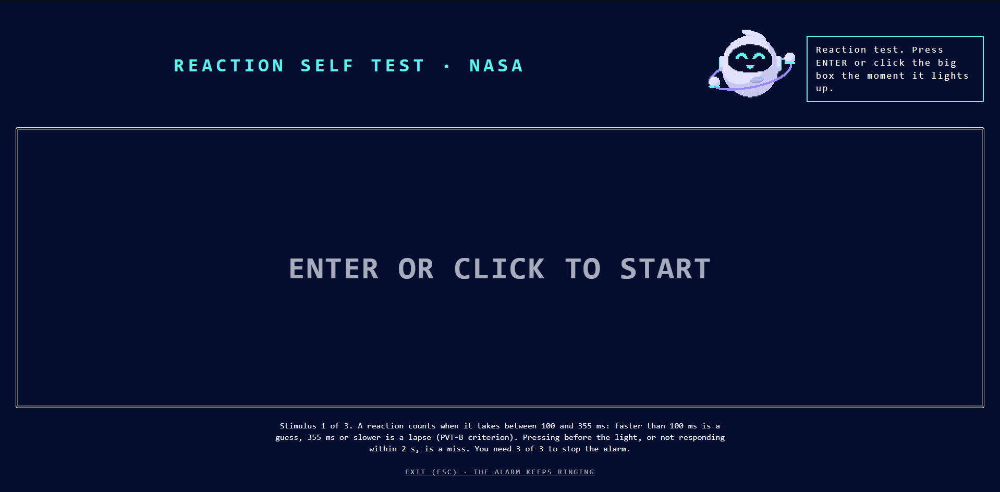

## Habit Journal

Four daily habits (sleep, exercise, hydration and relaxation) feed a daily score, a level and a streak, with 3-, 7- and 30-day views in the side panel. The expanded history shows the average score, good days, best streak, a per-habit strip and the best and weakest weekday, for 7, 30 or 60 days. The history in the demo is generated sample data, not real measurements, and the habit targets are team assumptions.

**Gamification to build good habits.** Every day earns up to 100 experience points in proportion to its score, and every 300 points raise the astronaut's level. A day at 80% or more counts as a good day and extends the streak. Badges reward a perfect day, a 3-day streak and a 7-day streak. When a habit's hour has passed and its target is not reached, the panel shows a reminder with what is left, for example how many glasses of water.

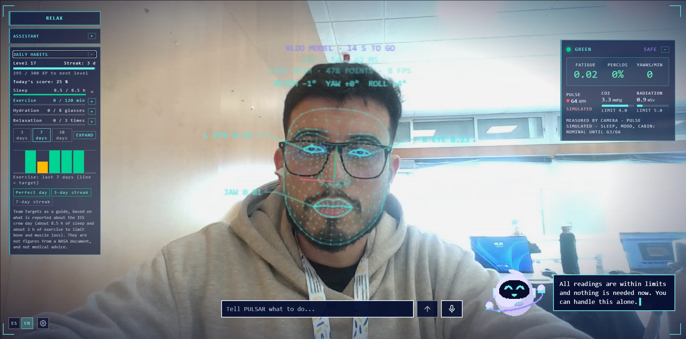
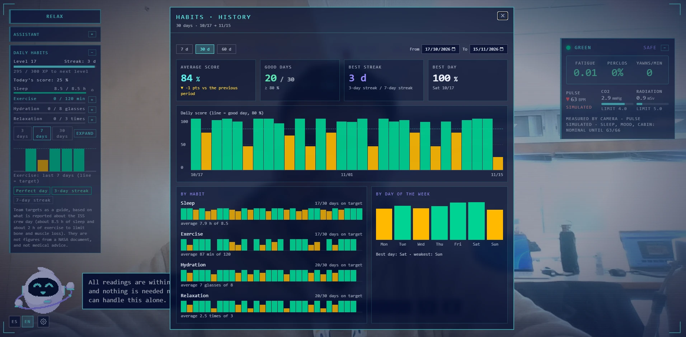

## Relaxation

Three guided exercises: slow breathing (5 cycles), eye rest (40 seconds) and release tension (80 seconds). They are general guidance, not a treatment, and the screen says so.

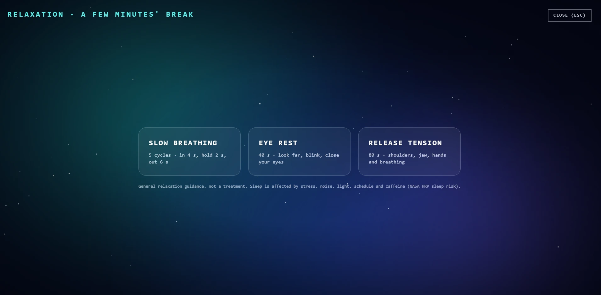

## The Data Behind Fatigue

The camera fatigue signal is not a formula we invented. The extraction, the model and its checks rest on these public datasets, papers and tools.

**Datasets**

| Dataset | What PULSAR uses it for |
| --- | --- |
| [UTA Real-Life Drowsiness Dataset (UTA-RLDD)](https://sites.google.com/view/utarldd/home), Ghoddoosian, Galib & Athitsos (2019) | Trains and validates the fatigue model: webcam and phone video labelled alert, low vigilance or drowsy; 24 of its 60 people, leave-one-subject-out |
| [DROZY](https://orbi.uliege.be/handle/2268/191620), Massoz, Langohr, François & Verly (2016), *The ULg Multimodality Drowsiness Database (called DROZY) and Examples of Use*, WACV 2016 | Held-out check against reaction time: 36 tests of 14 sleep-deprived people with a synchronised PVT. Nothing is trained on it and no frame is shown |
| [YawDD](https://ieee-dataport.org/open-access/yawdd-yawning-detection-dataset), Abtahi, Omidyeganeh, Shirmohammadi & Hariri (2014) | Calibrates the yawn detector: mouth opening of 0.26 or more held for at least 1 s, separating yawns from talking |

**Research**

- PERCLOS, the share of a minute with the eyes at least 80% closed: [FMCSA tech brief FHWA-MCRT-98-006 (1998)](https://rosap.ntl.bts.gov/view/dot/113) and [Dinges, Mallis, Maislin & Powell (1998), NHTSA DOT HS 808 762](https://rosap.ntl.bts.gov/view/dot/2518), which validated it against reaction-time lapses.
- Eye aspect ratio and blink detection from facial landmarks: [Soukupová & Čech (2016)](https://vision.fe.uni-lj.si/cvww2016/proceedings/papers/05.pdf).
- The reaction test's 355 ms lapse criterion: [Basner, Mollicone & Dinges (2011), PVT-B, Acta Astronautica](https://pmc.ncbi.nlm.nih.gov/articles/PMC3197786).

**Tools**

- [MediaPipe Face Landmarker](https://ai.google.dev/edge/mediapipe/solutions/vision/face_landmarker) (Google): face landmarks and eye-blink blendshapes, run the same way in the browser and in the Python training pipeline.
- [scikit-learn](https://scikit-learn.org/): the three-state logistic regression behind the fatigue score.

**What it achieves so far.** On RLDD the model reaches a macro-F1 of 0.43 and an AUC of 0.62 across three states. On DROZY, which it never saw, its score rises with PVT reaction time (Spearman 0.32 over 36 tests). That makes it an indicative signal, not a drowsiness detector.

## How It Addresses the Challenge

The challenge asks for health monitoring software that helps astronauts spot changes in their own health on long missions, without relying on the ground. PULSAR covers that loop on one device: it measures, decides with transparent rules, explains the result in plain language and shows the next step. Every limit is traceable, so the crew and the medical officer can see why PULSAR says what it says.

## Why It Matters

On a mission to deep space, a message to the ground can take minutes, and a crew cannot always wait for a doctor. A tool that works offline, explains itself and is simple enough to use under fatigue gives the crew an early, understandable second opinion. The aim is to help them notice a change sooner, not to replace clinical care.

## Scope and Limits

PULSAR is a decision-support prototype, not a medical device. In the demo the camera is real and measures fatigue, eye closure and yawns, while pulse, sleep, mood and cabin readings are simulated, and the alert screenshots use simulated values. PULSAR does not diagnose, does not detect SANS, and does not measure heart-rate variability through the camera. It reports what the rules engine decides from the readings it has, and it does not judge the values that have no rule yet.
